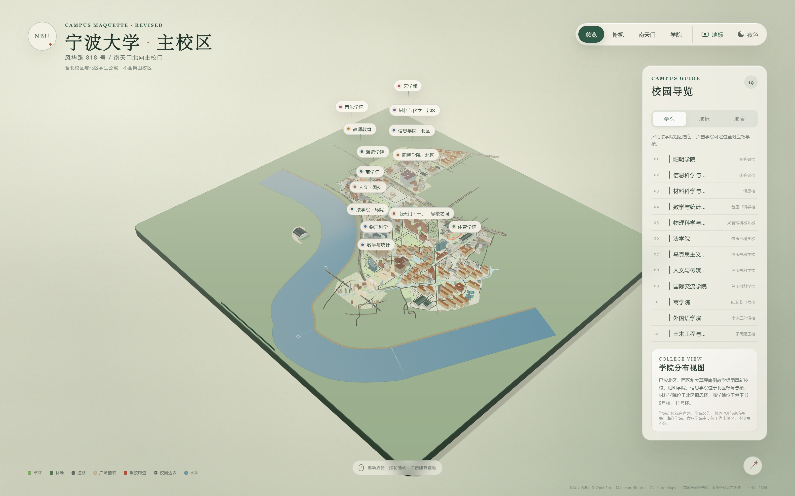
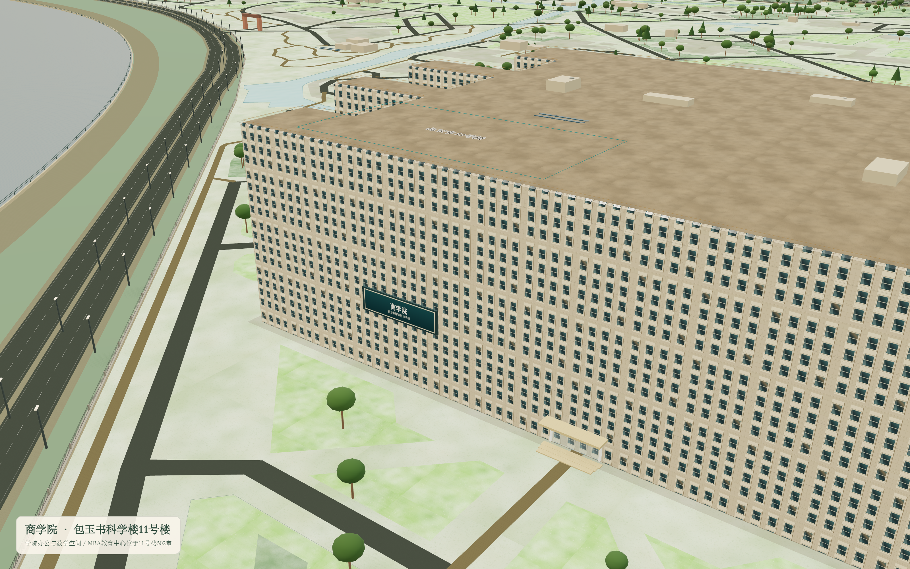
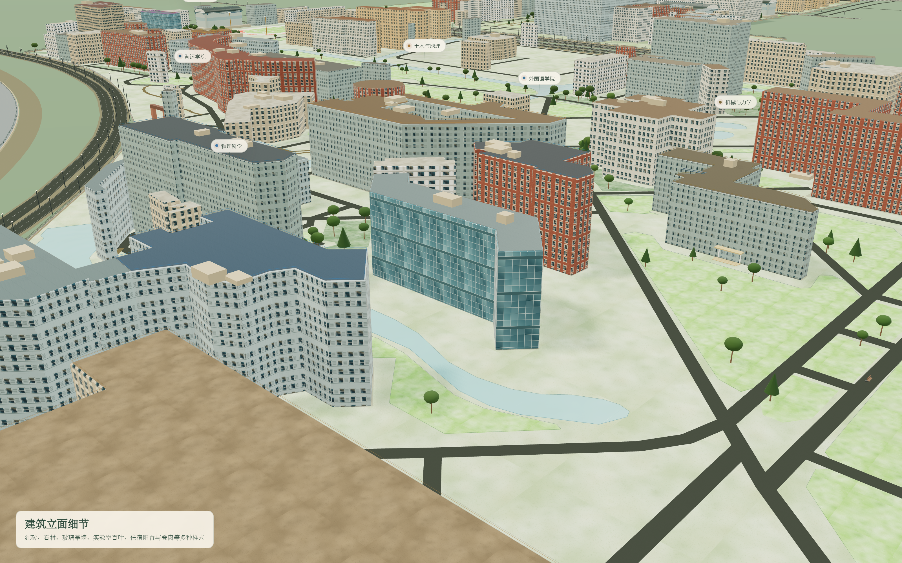
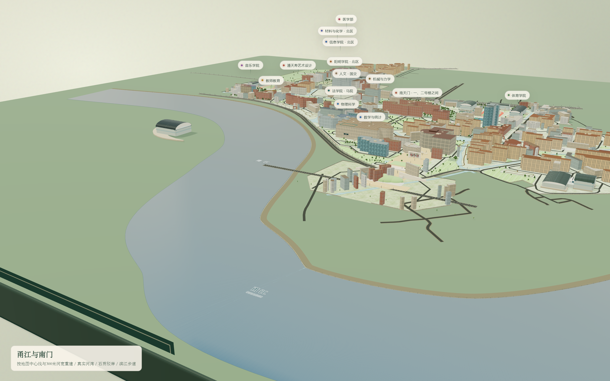
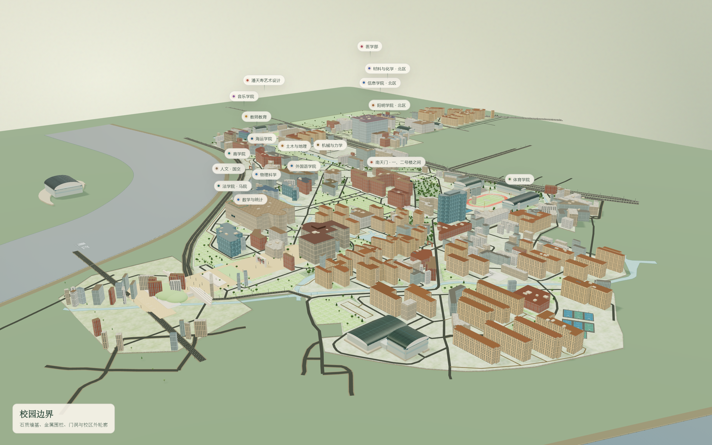

# 宁波大学主校区 3D 微缩模型

可直接在浏览器中旋转、缩放和查看的宁波大学主校区（不含梅山校区）三维微缩模型。

## 在线浏览

**在线体验：** <https://xltxl.github.io/ningbo-university-campus-maquette/>

- 交互式模型：`index.html`
- GLB 下载：[model.glb](./model.glb)
- 总览图：[screenshots/overview.png](./screenshots/overview.png)



## 模型特色

- 主校区、北校区与北区学生公寓，不含梅山校区。
- 南天门为主校门，门楼坐南朝北，北面接 44 级红砖大踏步。
- 商学院定位在包玉书科学楼 11 号楼，MBA 教育中心位于 11 号楼 502 室。
- 甬江按 OpenStreetMap 河道中心线及 300 米标注河宽重建，包含西侧入水、南侧河湾和东南回折，配石质驳岸、滨江步道、栏杆与动态水面。
- 校园外轮廓采用石质墙基和金属围栏，并在各入口处保留门洞。
- 分层的草地、林地、道路、广场、水系与塑胶跑道材质，增加法线纹理、粗糙度和宏尺度色差。
- 9 种建筑立面样式与 4 类屋面材质；包玉刚教学楼群、包玉刚图书馆及多栋老教学楼采用红砖立面，信息楼与安中大楼采用玻璃幕墙，实验楼采用百叶和金属面板。
- 立面使用颜色贴图、法线贴图、粗糙度贴图和独立 UV 偏移，玻璃与金属还会反射程序化天空环境。
- 地表采用 1024 像素程序纹理，并叠加宏尺度植被色差、割草纹、花点和多尺度法线细节。
- 李兴贵篮球场按 6 片场地、12 个篮架独立建模。
- 体育馆采用独立弧形屋面和玻璃门厅；东区司令台包含看台、座椅与指挥台。









## GitHub Pages 发布

1. 在 GitHub 新建一个空仓库，例如 `ningbo-university-campus-maquette`。
2. 将本目录内的全部文件上传到仓库默认分支的根目录。
3. 打开仓库 `Settings → Pages`。
4. 在 `Build and deployment` 中选择 `Deploy from a branch`。
5. 选择默认分支（通常为 `main`）和根目录 `/`，保存。
6. 等待 GitHub Actions 完成部署后，网站地址通常为：

```text
https://<你的GitHub用户名>.github.io/ningbo-university-campus-maquette/
```

本仓库已经发布在：

```text
https://xltxl.github.io/ningbo-university-campus-maquette/
```

## 本地预览

在本目录运行：

```powershell
python -m http.server 8000
```

然后访问 `http://localhost:8000/`。

## 说明

- 校园边界、建筑基底和道路参考 © OpenStreetMap contributors，数据采用 ODbL 1.0。
- 建筑高度、门窗、屋顶设备与景观细节为微缩模型的艺术化补全，不是测绘或施工依据。
- 本模型用于校园空间展示与交流。
